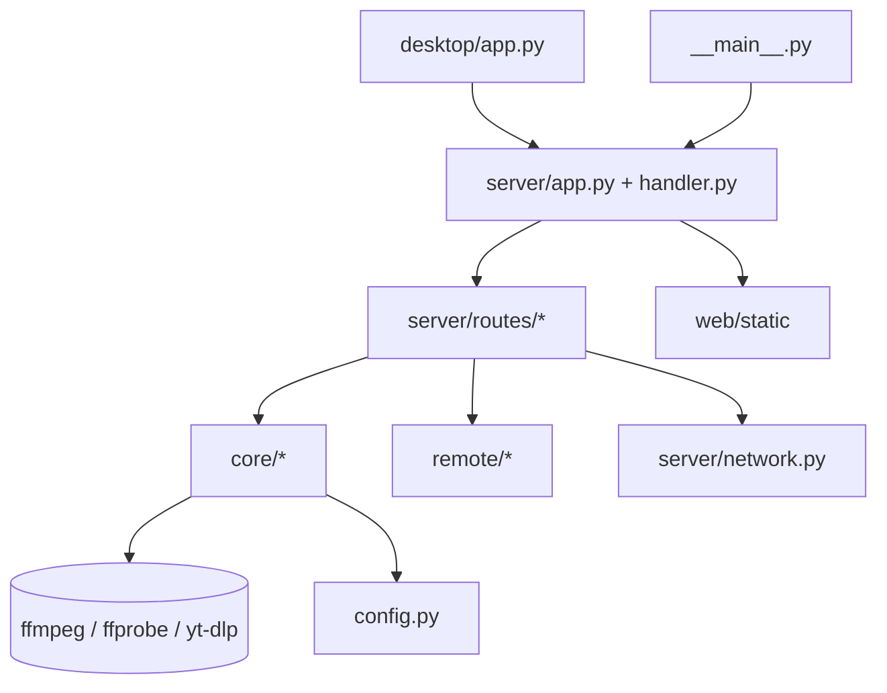

# Architecture

SWARARIA AUDIO LAB is a local-first Python application (stdlib HTTP server + vanilla-JS UI) that wraps
FFmpeg and yt-dlp. This document describes the code layout and the rules that keep it maintainable.

## Layers



| Package | Responsibility | May import |
|---|---|---|
| `swararia.config` | filesystem locations (`REPO_ROOT`, `STATIC_DIR`) | nothing |
| `swararia.core` | domain logic: audio analysis/conversion, yt-dlp, filesystem ops, task queue | `config`, `core` |
| `swararia.remote` | native (Android) remote: pairing/sessions and TLS listener | `config`, `remote` |
| `swararia.server` | HTTP server, security gates, REST routes, browser-remote hub | `core`, `remote`, `config`, `server` |
| `swararia.desktop` | pywebview window / app-mode launcher | everything below |

The rules are enforced by [`tests/python/test_architecture.py`](../tests/python/test_architecture.py).

## Python package map

- `core/audio_manager/` - `constants`, `toolchain` (bundled binaries), `ytdlp_engine`, `audio_analysis`
  (ffprobe/EBU R128/spectral), `yt_cookies`, `yt_search`, `yt_playlist`, `conversion`, `cli`.
  `__init__` re-exports every name, so `from swararia.core import audio_manager; audio_manager.metadata(...)` works.
- `core/fs_browser/` - `safe_paths` (allowed roots, validation), `browse`, `entry_ops`, `rename_history`,
  `batch_rename`, `organize` (also re-exported from `__init__`).
- `server/` - `state` (paths, `APP_VERSION`, singletons), `system`, `updates`, `network` (LAN/WSL/Windows bridge),
  `hub` (`RemotePlayerHub`), `handler` (`AudioServerHandler`), `app` (server classes, `create_server`, `main`),
  and `routes/` mixins composed into the handler.

### Cross-module references and testing

Modules reference collaborators through the module (`state.COOKIES_FILE`, `hub.remote_hub`), never by copying
names, so tests patch the *defining* module (`patch.object(network, "get_local_lan_ips", ...)`).

## Adding an HTTP route

1. Add the handler method to the matching mixin in `server/routes/` (`get.py` for GET, `post_*.py` for POST).
2. Wire the path in `do_GET` / `do_POST` (`routes/get.py` / `routes/post.py`).
3. Add the route literal to `tests/python/route_table.txt` so the route-table guard protects it.

## Frontend (`web/static`, served at `/static/`)

- `pages/<page>/index.html` + `index.js` - one folder per page (`ingest`, `qc`, `converter`, `organizer`,
  `multitrack`, `video-split`, `player`). The server maps `/`, `/qc`, ... to these files.
- `modules/` - shared ES modules (router, shared UI, modals, dock, notifications).
- `css/` and `assets/` - styles and images.
- No bundler. `modules/spa-router.js` lazy-imports page scripts by URL; `HTML` and the router must use the same
  URL so a page module is only evaluated once.
- `tests/python/test_static_integrity.py` verifies every `/static/...` reference and relative import resolves.

## Packaging

`packaging/` holds the PyInstaller spec, Inno Setup script and builders. The spec bundles the whole `swararia`
package (`collect_submodules`) plus `web/static` and starts from `packaging/launcher.py`.

## Running the checks

```bash
python -m pytest                       # or: python tests/python/run_tests.py (no pytest needed)
for f in tests/js/*.test.mjs; do node "$f"; done
ruff check swararia tests
```
